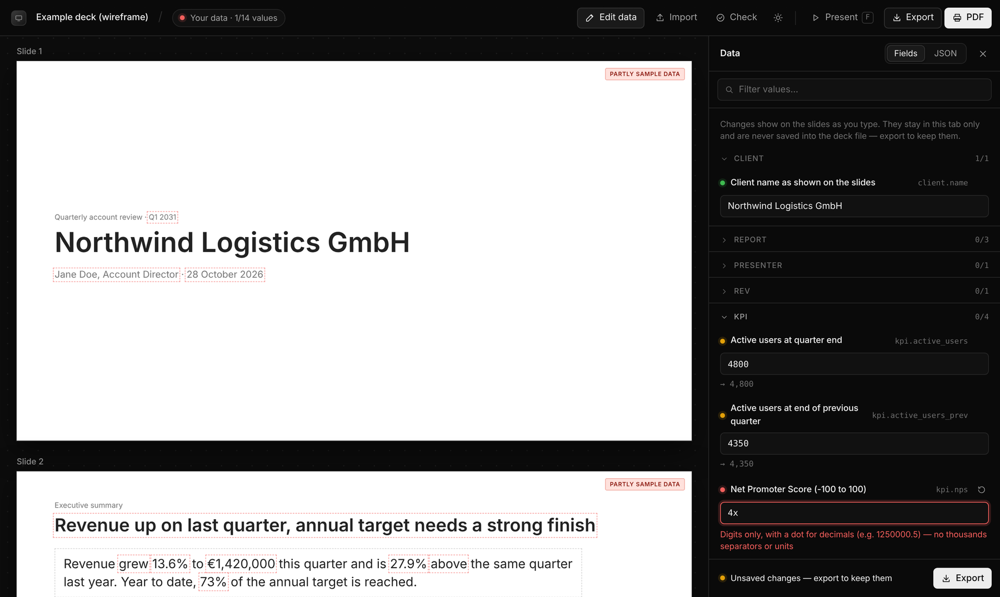
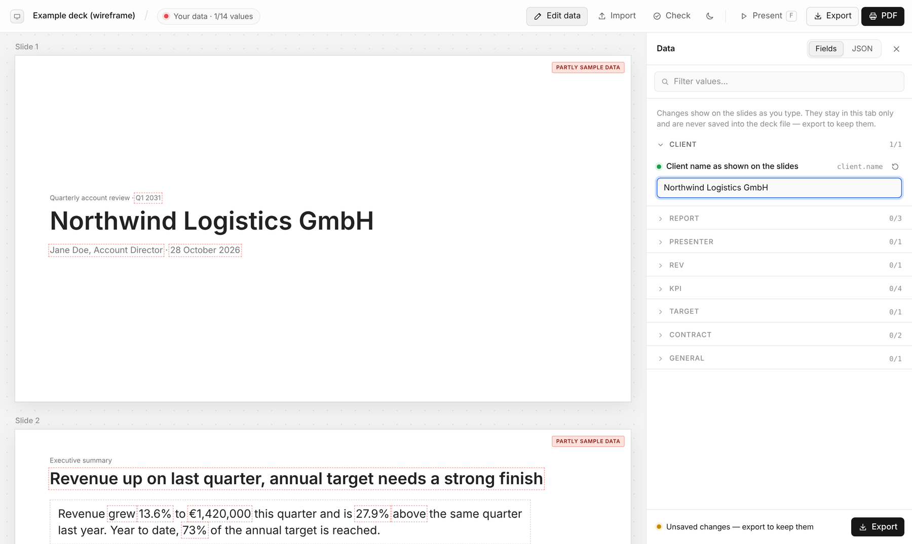

# Confidential HTML deck

A Claude skill for building presentation decks from confidential data without sharing that data with Claude.

Claude builds the deck as one self-contained HTML file in PowerPoint's 16:9 format. Every sensitive value (client names, revenue, KPIs, dates, deal terms) is a variable holding **dummy data**. You open the file in your browser, enter or import the real values, and print it to PDF. Claude only ever sees the dummy version.



## How it keeps your data local

| What Claude sees | What stays on your machine |
|---|---|
| Layout, wording, charts, calculations | The real values |
| Dummy values such as "Example Corporation" | Your data file (`<deck>-data.json`) |
| A PDF preview rendered with dummy values | The final PDF with real data |

- **No network.** A Content Security Policy blocks every request: the deck can't load or send anything. Fonts and logos are embedded.
- **Values stay in the tab.** Real values live only in the browser tab's memory and are never written into the HTML. There's deliberately no "save filled deck" option.
- **Visible sample data.** Every slide carries a "Sample data" badge until all values are yours. Values still on their sample are outlined, and printing warns you first.
- **Calculated, not typed.** Totals, growth rates, shares, and wording such as "grew"/"declined" or the headline are calculated in the page. They stay correct once the real numbers are in.
- **Leak checks.** If an HTML file was saved from the browser after data was loaded, the deck shows a red warning and the skill's checks refuse to work from it.

## The workflow

1. **Brief.** Tell Claude what the deck is for, the design language (colours, type, logo, layout character) and the *shape* of your data: how long the names are, rough magnitudes, how many rows. The skill has no house style, so every deck is designed from your brief.
2. **Iterate on the design.** Each version comes with a PDF preview rendered from the dummy data, shown in the chat. You give feedback on the preview without switching windows.
3. **Add your data.** When the design is final, open the HTML in Chrome or Edge and click **Edit data**:
   - type values into the form, or edit the raw JSON;
   - or **Import** / drag in your JSON file from last time.

   The slides update as you type. **Export** saves your values as JSON for the next edition.
4. **Print.** Click **PDF**. You get one page per slide at 13.33 × 7.5 in.
5. **Next version.** Upload only the deck HTML, never your data JSON or a filled PDF. Claude keeps the variable keys stable and lists any values that were added, renamed or removed.

## The viewer



The viewer is part of every deck and is never printed.

- **Edit data:** values are grouped into collapsible sections, each showing how many of its values are yours. There's a filter box, and each field shows its status (sample / yours / invalid) and a formatted preview. Lists are edited as a small grid. A JSON tab lets you paste or edit everything at once.
- **Strict input.** Numbers are plain (`1250000.5`), percentages may be typed as `12.5%`, and dates use a picker. Ambiguous input like `1.000` is rejected rather than guessed, so the same data always produces the same deck.
- **Check:** lists missing, invalid and still-sample values, undefined variables and failed calculations.
- **Present** (`F`), **Export**, **PDF**, and a light/dark switch that follows your system setting. The light/dark choice is the only thing the deck stores in your browser.

> **macOS note:** Gatekeeper may block a downloaded `.json` file when you double-click it. You never need to open it: use **Import** or drag it onto the deck.

## Install

**Claude apps:** download `confidential-html-deck.skill` from the [latest release](../../releases/latest) and add it in Claude's skill settings.

**Claude Code:** copy the skill folder into your skills directory:

```bash
git clone https://github.com/tokuhn/confidential-html-deck.git
cp -r confidential-html-deck/skills/confidential-html-deck ~/.claude/skills/
```

Then ask Claude for a deck with confidential data, for example: *"Make a quarterly account review deck for a client. Keep all client figures as placeholders."*

The skill's check scripts need Python 3. The rendering check and PDF preview also need [Playwright](https://playwright.dev/python/) with Chromium (`pip install playwright pypdf && python -m playwright install chromium`). Without Playwright, Claude runs only the static check and says there's no preview.

## Try the example

[`examples/example-deck.html`](examples/example-deck.html) is a five-slide wireframe. It shows the mechanics (calculated headline, chart and table from a list, progress bar, wording that follows the data) and deliberately has no design. Open it in your browser and click **Import** with [`examples/example-data.json`](examples/example-data.json) to see the slides switch to that data set. [`examples/example-deck-preview.pdf`](examples/example-deck-preview.pdf) is the dummy-data preview Claude would show you in the chat.

All names and figures in the examples are invented.

## What's in the skill

```
skills/confidential-html-deck/
├── SKILL.md                 instructions Claude follows
├── assets/
│   ├── deck-template.html   starting point: variables, empty design sections, runtime
│   └── example-deck.html    wireframe reference for patterns
├── references/runtime.md    types, formats, tables, charts, calculations, viewer
└── scripts/
    ├── lint_deck.py         privacy and consistency checks (stdlib only)
    ├── render_check.py      headless render with sample + stress values, PDF preview
    └── update_runtime.py    upgrades an older deck's runtime in place
```

## Limitations

- Output is HTML and PDF. There's no editable `.pptx`; you change the deck by asking Claude.
- Charts are built in: bar, horizontal bar and line. Other visuals are drawn per deck with a small custom render hook.
- The PDF preview uses the fonts installed where Claude works. Typefaces that aren't embedded in the deck may look slightly different in the preview than in your browser.
- The privacy model relies on you not uploading your data JSON, a PDF printed with real data, or a deck saved from the browser after loading data. The deck and the skill warn about the last case but can't stop you from sharing a file.

## License

[MIT](LICENSE)
